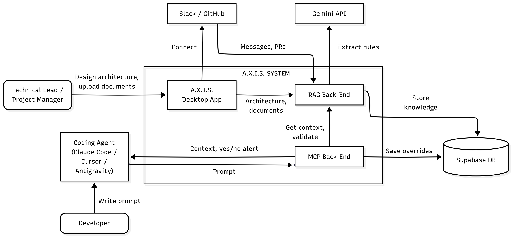
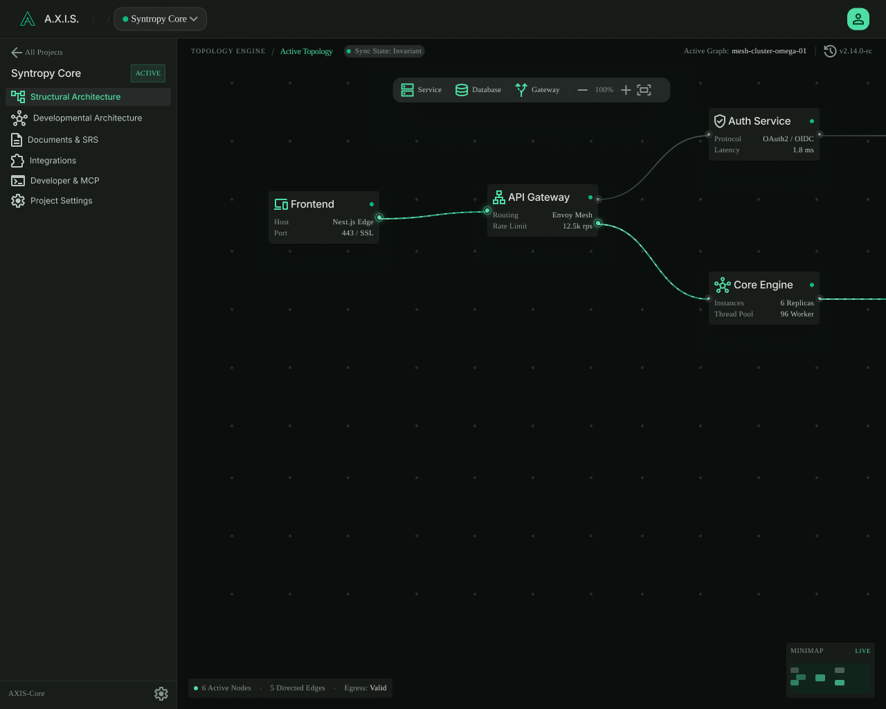
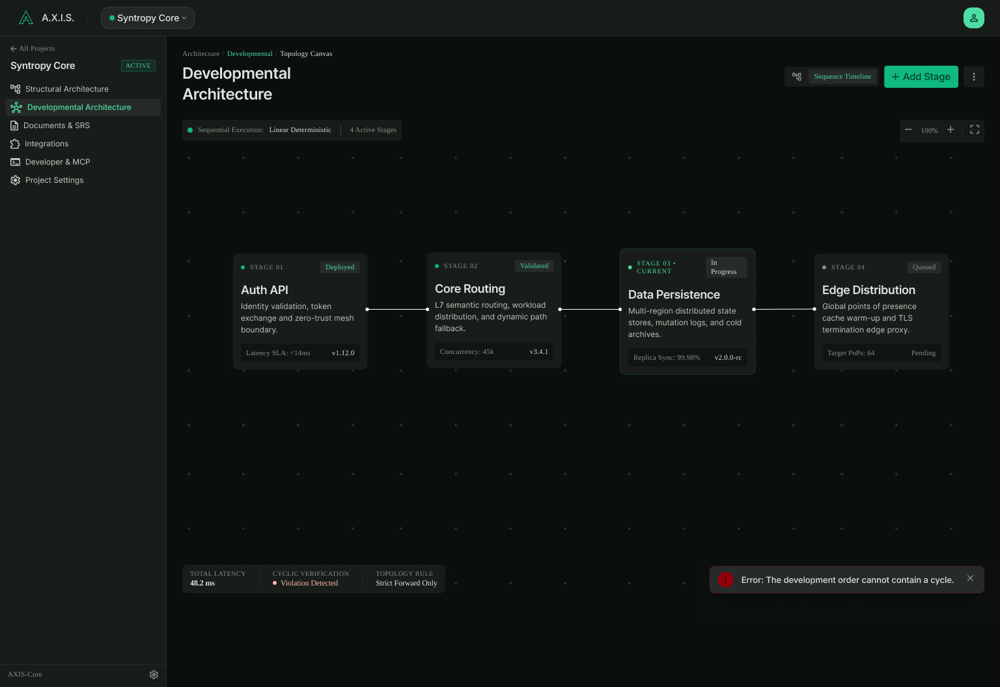
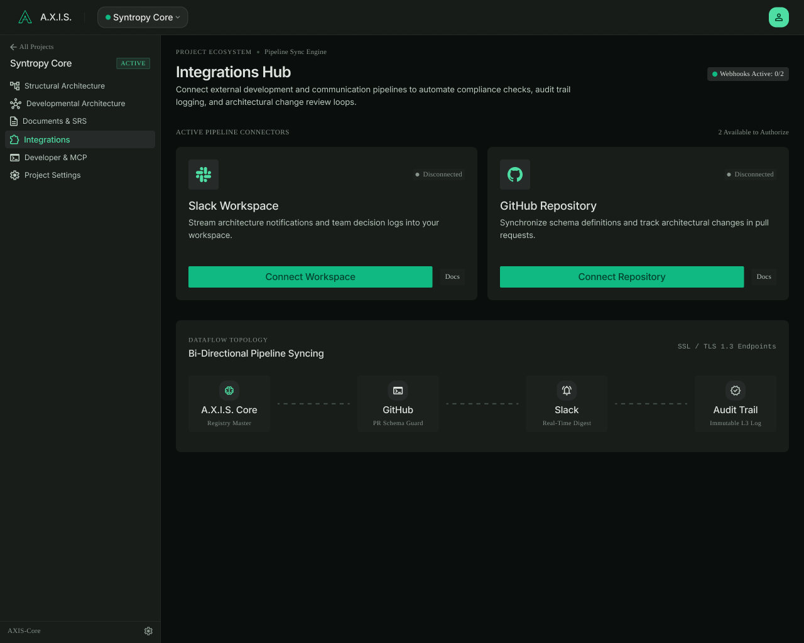
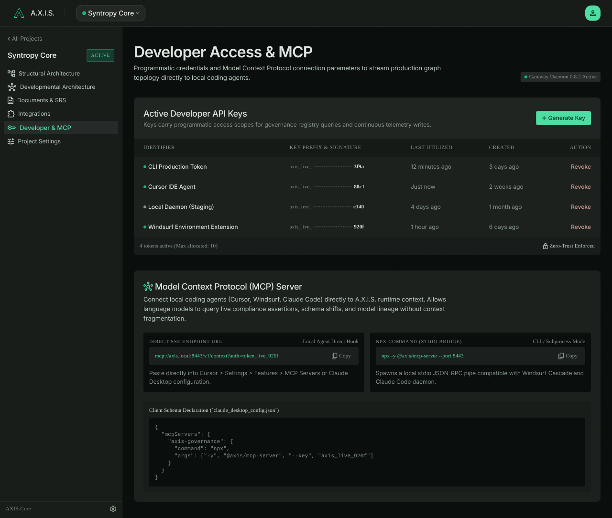
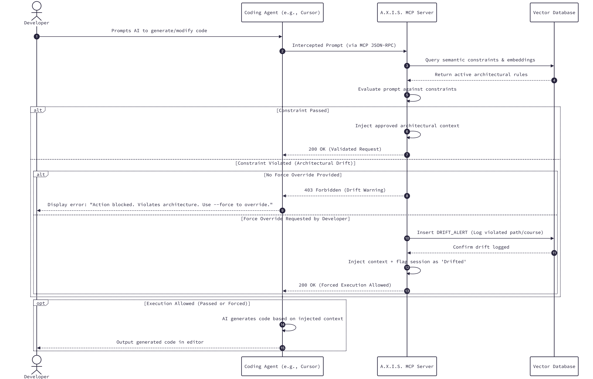

# A.X.I.S. — Architecture & Execution Intelligence Studio

**A "company brain" that turns a software team's scattered decisions into a live knowledge graph, and makes AI coding agents follow them.**

`Model Context Protocol` · `AI Coding Agents` · `Retrieval-Augmented Generation` · `Traceability Graph` · `Human-in-the-Loop`

Final Year Project, BS Computer Science, FAST-NUCES Lahore
**Team:** Ahmed Nasir · Baber Ali · Abdur Rehman  |  **Supervisor:** Dr. Mirza Mubasher Baig

---

## The problem

AI coding agents such as Claude Code, Cursor and Antigravity write code fast, but they cannot see what the team has decided. Requirements, architectural decisions and the planned order of work are scattered across Slack threads, GitHub pull requests, SRS documents and people's heads. The agent ends up breaking architectural boundaries, using decisions the team has already reversed, and building features out of order, so senior developers must review AI-generated code by hand.

## The solution

A.X.I.S. collects knowledge from **Slack, GitHub, SRS documents and a visual architecture canvas**, uses an LLM to extract requirements, decisions and constraints, and keeps them in a **traceability graph** where outdated decisions are superseded and every rule links back to its source. Through a single **MCP server**, any compatible coding agent receives the relevant, current context before writing code. If a request conflicts with a team decision, the developer gets a **yes/no confirmation inside their own coding agent**, and every override is recorded.

> **Example:** The team switched from JazzCash to Stripe in Slack on 12 Sep. A developer later asks Claude Code to *"integrate JazzCash in checkout."*
> A.X.I.S. responds: *"This conflicts with DEC-31: the team switched to Stripe (Slack #payments, 12 Sep, Team Lead). Do you want to proceed?"*

## Architecture

| Subsystem | Responsibility | Technology |
|---|---|---|
| Desktop App | Projects, architecture canvases, integrations, document upload, developer API keys | React, React Flow, Tauri |
| RAG Back-End | Ingestion, LLM extraction, superseding, hybrid retrieval, semantic linter | Python, FastAPI, Gemini API, fastembed |
| MCP Back-End | Single entry point for coding agents, API-key auth, Human-in-the-Loop | Python, FastMCP |
| Database | App data, traceability graph, embeddings, decision log | Supabase (PostgreSQL + pgvector) |

## Repository contents

| Folder | Contents |
|---|---|
| [`docs/`](docs) | Competition proposal and the FYP report (v1: vision, related work, requirements, design) |
| [`design/screens/`](design/screens) | UI designs of all application screens |
| [`diagrams/`](diagrams) | System architecture, ER diagram, class diagram |
| [`diagrams/sequence/`](diagrams/sequence) | Sequence diagrams of the six core workflows |

## UI designs

| | |
|---|---|
|  **Structural architecture canvas** |  **Developmental architecture canvas** |
|  **Slack & GitHub integration** |  **Developer API keys & MCP setup** |

More screens are in [`design/screens/`](design/screens).

## Key workflow: prompt interception and validation

## Status

Requirements specification and system design are complete. Implementation is planned over 12 weeks: foundation and canvas, knowledge engine, MCP server and retrieval, linter and Human-in-the-Loop, then evaluation on a prepared test project. See [`docs/AXIS_Proposal.md`](docs/AXIS_Proposal.md) for the full plan.
